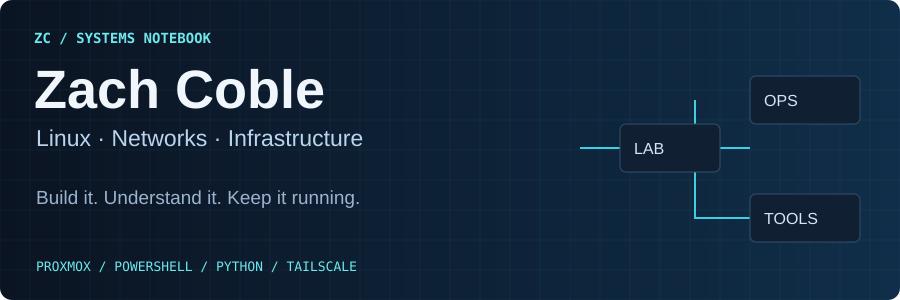
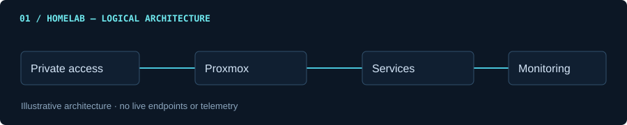
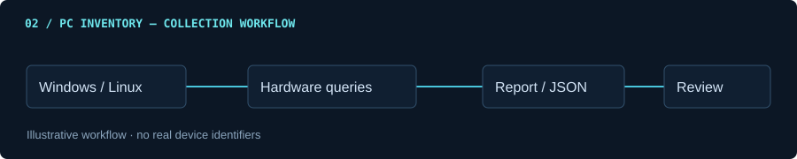
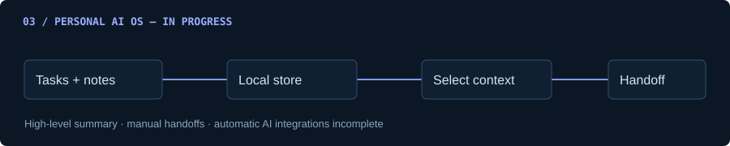

I build practical IT tools and document the systems behind them. Explore my homelab, Windows and Linux automation, and work on local AI workflows.

## Selected projects

### Homelab Infrastructure

My self-hosted infrastructure notebook: Proxmox virtualization, private remote access, service monitoring, and the decisions behind running a homelab.

**Proxmox · Linux · Tailscale · n8n · Jellyfin · Nextcloud · Pi-hole** 
[Explore the homelab →](https://github.com/zachcoble/homelab)

### PC Inventory Toolkit

Hardware inventory built around a practical question: what information do I need to order a compatible replacement or upgrade? Windows and Linux scripts, structured reports, and a parts-ordering field guide.

**PowerShell · Bash · CIM/WMI · Linux hardware tools** 
[View the toolkit →](https://github.com/zachcoble/pc-inventory-toolkit)

### Personal AI OS · In progress

A local workspace for tasks, notes, shortcuts, backups, and manually prepared AI handoffs. Private implementation; automatic AI integrations are still in development.

**Python · SQLite · HTML/CSS · JavaScript**

## Tools I build with

**Infrastructure** — Proxmox, Linux, Tailscale 
**Automation** — PowerShell, Bash, n8n 
**Local applications** — Python, SQLite, JavaScript

## Also building

[**CashFlow →**](https://github.com/zachcoble/cashflow) A local income-allocation planner built with FastAPI, SQLite, and vanilla JavaScript.

---

Interested in Linux administration, networking, infrastructure engineering, data center operations, and useful automation.

Project diagrams are illustrative; operational configuration and personal data stay private.
